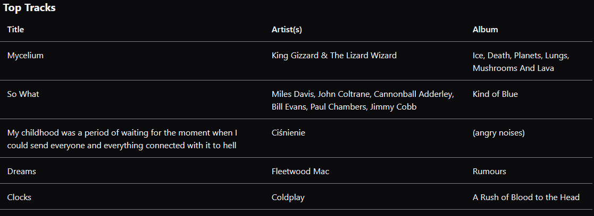
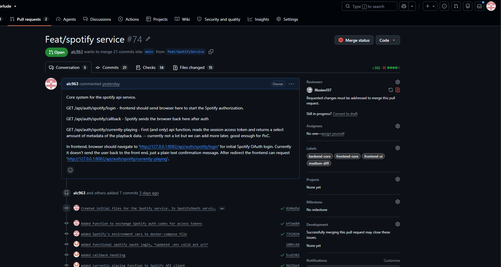
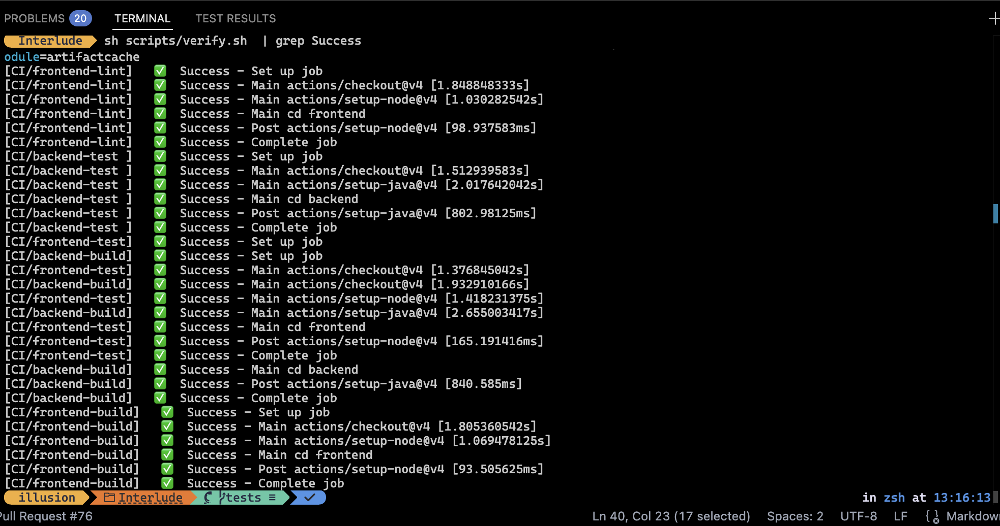

# 1. Introduction
## 1.1 Objective
Our objective is to collect user's music data, so that they can connect with others of similar music taste, share their favorite tracks and artists, and get better music recommendations.
## 1.2 Requirements
**Description:**
For heavy music listeners who care about how their music is delivered or who want to share their music listening habits, Interlude is a music tracker that aims to give listeners an automatic music diary that tracks and visualizes their listening history over time, while using that history and time of day to recommend new music and resurface older songs that fit what they want to hear right now, unlike Last.fm, our product will integrate directly into your streaming service of choice to give users a better music service experience with the UI they're familiar with.

**Value proposition:**
Interlude aims to give listeners an automatic music diary that tracks and visualizes their listening history over time, while using that history and time of day to recommend new music and resurface older songs that fit what they want to hear right now.

**MVP (for this release):**
- Signup and Login into account
- Spotify account authentication
- Dashboard that contains track that you are currently listening to

**Repository:** [github.com/alc963/Interlude](https://github.com/alc963/Interlude/)

# 2. Implemented Requirements

## 2.1 Daniel Raygoza
[Pull Requests](https://github.com/alc963/Interlude/pulls?q=is%3Apr+author%3AIllusion137)

Requirement: User Authentication
Requirement Description: As a user, I want to create an account and log in so that I can securely access my Interlude account. (backend of it)
Issue Link: https://github.com/alc963/Interlude/issues/79
Pull Request Link(s): https://github.com/alc963/Interlude/pull/63
Author: Daniel Raygoza / Illusion137
Reviewer: Kacy Souvanna / kas2536
Automated Testing: https://github.com/alc963/Interlude/blob/main/backend/src/test/java/com/naugroup3/interlude/controllers/AuthenticationControllerTest.java.

## 2.2 Kacy Souvanna
[Pull Requests](https://github.com/alc963/Interlude/pulls?q=is%3Apr+author%3Akas2536)

Requirement Description: As a user i want to sign up and login so i can use the service. 
Issue Link: https://github.com/alc963/Interlude/issues/80
Pull Request Link(s): https://github.com/alc963/Interlude/pull/73
Author: Kacy Souvanna (kas2536)
Reviewer: Daniel Raygoza (illusion137)
Automated Testing: 
Visual Evidence: [Sign In page](<Screenshot 2026-10-23 191334.png>)

## 2.3 Jeff Henry
[Pull Requests](https://github.com/alc963/Interlude/pulls?q=is%3Apr+author%3AChairmichael)

- Requirement Description: As a user, I want to view my recent top tracks, so that I can share with my friends.
- Issue Link: https://github.com/alc963/Interlude/issues/72
- Implemented by: Jeff Henry
- Reviewer: 
- Automated Testing:
- Visual Evidence: 

## 2.4 Aidan Clarke
[Pull Requests](https://github.com/alc963/Interlude/pulls?q=is%3Apr+author%3Aalc963)

Requirement: Spotify Account Connection
Requirement Description: As a user, I want to connect my Spotify account and view my currently playing track on the dashboard.
Issue Link: https://github.com/alc963/Interlude/issues/53
Pull Request Link(s): https://github.com/alc963/Interlude/pull/74
Author: Aidan Clarke / alc963
Reviewer: Daniel Raygoza / illusion137
Automated Testing: 
backend/src/test/java/com/naugroup3/interlude/controllers/spotify/SpotifyApiControllerTest.java
backend/src/test/java/com/naugroup3/interlude/controllers/spotify/SpotifyOAuthControllerTest.java
backend/src/test/java/com/naugroup3/interlude/services/Spotify/SpotifyApiClientTest.java
backend/src/test/java/com/naugroup3/interlude/services/Spotify/SpotifyOAuthServiceTest.java

## 2.5 Sarah Rogala
[Pull Requests](https://github.com/alc963/Interlude/pulls?q=is%3Apr+author%3Acringeybabey)

# 3. Automated Testing

**Testing Frameworks:**
- Vitest *(frontend)* - We are using `Vitest` because some of our team members are familar with the framework.
- JUnit *(backend)* - `JUnit` is the standard testing framework for `Java`, so we used it since there was more documentation for it than others.

**Test Locations:**
- [Vitest Frontend](https://github.com/alc963/Interlude/tree/main/frontend/test)
- [JUnit Backend](https://github.com/alc963/Interlude/tree/main/backend/src/test/java/com/naugroup3/interlude)

**Test Example:**
1. [AuthenticationControllerTest File](https://github.com/alc963/Interlude/blob/main/backend/src/test/java/com/naugroup3/interlude/controllers/AuthenticationControllerTest.java)
2. [Code being tested](https://github.com/alc963/Interlude/blob/main/backend/src/main/java/com/naugroup3/interlude/controllers/AuthenticationController.java)
3. This tests validates the `/auth/login` and `/auth/signup` endpoints and their functionality. Functionality such as, if JWTs are returned on success, whether the usernames service gets updated, how it handles duplicate data, and how it handles unregistered credentials.

**Test Results:**

# 4. Technology Stack
## 4.1 React (TypeScript)
**Description:** We use `TypeScript` as our frontend language of choice alongside our framework of `React` to display our frontend to users.

**Justification:** `TypeScript` allows us to catch potential errors easier before they reach production for almost no extra cost. `React` allows us to modularize our frontend components to be reused and repurposed with easy state management.

## 4.2 Tailwind (CSS)
**Description:** `Tailwind` is used to style our frontend components.

**Justification:** `Tailwind` provides great flexibility in styling and a small bundle size.

## 4.3 Spring Boot (Java)
**Description:** `Java` is our backend language of choice combined with the `Spring Boot` framework to create our API. 

**Justification:** `Spring Boot` is heavily used in the industry and our team wanted to become familar with it. Moveover, it abstracts away a lot of complexity, making it fairly simple to get going.

## 4.4 Postgres (SQL)
**Description:** Our database in our system.

**Justification:** `Postgres` is a standard database that is often used in production environments that our team wanted to become familar with. Moreover, it provides a large toolset out of the box.

# 5. Learning Strategy
- Learning resources used
  - [Spring Boot Docs](https://docs.spring.io/spring-boot/index.html)
  - [React Docs](https://react.dev/learn)
  - [Spotify Web API](https://developer.spotify.com/documentation/web-api)
  - Claude (For learning)
- Knowledge sharing methods within the team
  - Talk about technologies during meetings.
- Challenges faced and how you overcame them
  - Spring Boot was very new, however by coding with it, we better came to understand the framework.
- Time investment in learning new technologies
  - The majority of development time. 

# 6. Deployment

**Live System Link:**
- Frontend: [interlude.sumii.me](https://interlude.sumii.me/)
- Backend: [iapi.sumii.me](https://iapi.sumii.me/)

**Deployment Method:** Our deployment is done through a GitHub workflow that `ssh` into our VPS and pulls the latest commit to main, and then using `docker rollout` deploys the application with zero downtime.

**Platform Justification:** Having used other platforms such as `AWS` and `Azure`, we wanted to use a platform that wouldn't be too expensive, while also giving us low-level control of our system so that we could learn about managing our own server. Thus we got a VPS with Contabo and is what we deploy to.

# 7. Licensing

**License:** GNU GPLv3

**Why:** This project is a commercial large scale project with a lot of time and effort put into it, therefore, somebody else taking and improving our product without sharing their improvements is something we wouldn't want. 

# 8. Repository Documentation

[**README**](../README.md)

[**LICENSE**](../LICENSE)

# 9. User Interface Design

**Design Approach:** Every component should be very modularized for reusability and readability. For the user experience we wanted everything quite minimal as to not bloat the user eyes.

**Visual Examples:**

**Usability Considerations:**

# 10. Retrospective Analysis

**Key Learnings:**
- How to learn unfamiliar languages and frameworks.
- How to effectively communicate as a team.

**Challenges Overcome:**
- One team member sick for some weeks, which was solved by other team members stepping up to cover their work.
- Two absent team members, which was also solved by other team members contributing more to cover their work.

**Future Improvements:**
- Music Analysis
- Music Recommendations
- Live Music Tracking
- Friends System

# 11. System Demonstration