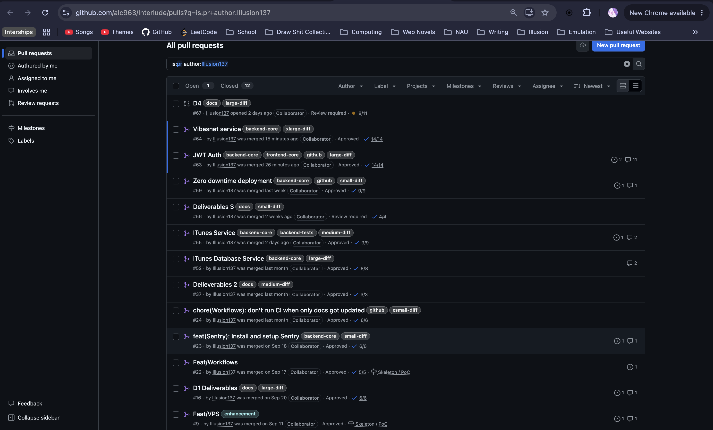

# 1. Introduction
## Objective
## Requirements
**Description:**

**Value proposition:**

**MVP:**

**Repository:** [github.com/alc963/Interlude](https://github.com/alc963/Interlude/)

# 2. Implemented Requirements

## 2.1 Daniel Raygoza
[Pull Requests](https://github.com/alc963/Interlude/pulls?q=is%3Apr+author%3AIllusion137)

## 2.2 Kacy Souvanna
[Pull Requests](https://github.com/alc963/Interlude/pulls?q=is%3Apr+author%3Akas2536)

## 2.3 Jeff Henry
[Pull Requests](https://github.com/alc963/Interlude/pulls?q=is%3Apr+author%3AChairmichael)

## 2.4 Aidan Clarke
[Pull Requests](https://github.com/alc963/Interlude/pulls?q=is%3Apr+author%3Aalc963)

## 2.5 Sarah Rogala
[Pull Requests](https://github.com/alc963/Interlude/pulls?q=is%3Apr+author%3Acringeybabey)

# 3. Automated Testing

**Testing Frameworks:**
- Vitest *(frontend)*
- JUnit *(backend)*

**Test Locations:**
- [Vitest Frontend](https://github.com/alc963/Interlude/tree/main/frontend/test)
- [JUnit Backend](https://github.com/alc963/Interlude/tree/main/backend/src/test/java/com/naugroup3/interlude)

**Test Examples:**

**Test Results:**

# 4. Technology Stack
## 4.1 React (TypeScript)
**Description:**

**Justification:**

## 4.2 Tailwind (CSS)
**Description:**

**Justification:**

## 4.3 Spring Boot (Java)
**Description:**

**Justification:**

## 4.4 Postgres (SQL)
**Description:**

**Justification:**

# 5. Learning Strategy

# 6. Deployment

**Live System Link:**
- Frontend: [interlude.sumii.me](https://interlude.sumii.me/)
- Backend: [iapi.sumii.me](https://iapi.sumii.me/)

**Deployment Method:** Our deployment is done through a GitHub workflow that `ssh` into our VPS and pulls the latest commit to main, and then using `docker rollout` deploys the application with zero downtime.

**Platform Justification:** Having used other platforms such as `AWS` and `Azure`, we wanted to use a platform that wouldn't be to expensive, while also giving us low-level control of our system so that we could learn about managing our own server. Thus we got a VPS with Contabo and is what we deploy to.

# 7. Licensing

**License:** GNU GPLv3

**Why:** This project is a commercial large scale project with a lot of time and effort put into it, therefore, somebody else taking and improving our product without sharing their improvements is something we wouldn't want. 

# 8. Repository Documentation

[**README**](../README.md)

[**LICENSE**](../LICENSE)

# 9. User Interface Design

**Design Approach:**

**Visual Examples:**

**Usability Considerations:**

# 10. Retrospective Analysis

**Key Learnings:** 

**Challenges Overcome:** 

**Future Improvements:**

# 11. System Demonstration