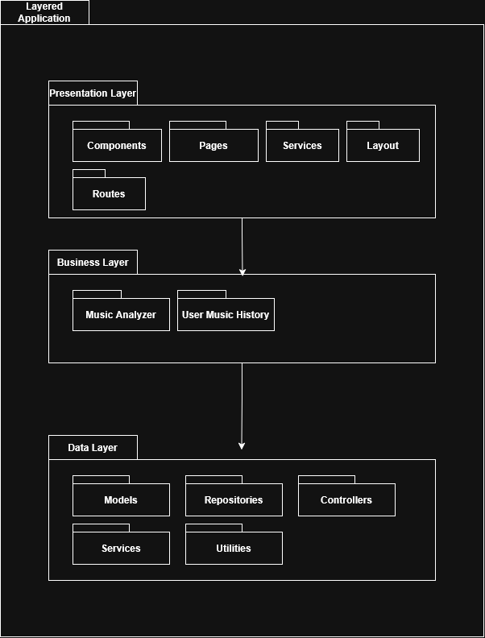

# 1. Description
For heavy music listeners who care about how their music is delivered or who want to share their music listening habits, Interlude is a music tracker that aims to give listeners an automatic music diary that tracks and visualizes their listening history over time, while using that history and time of day to recommend new music and resurface older songs that fit what they want to hear right now, unlike Last.fm, our product will integrate directly into your streaming service of choice to give users a better music service experience with the UI they're familiar with.

# 2. Architecture


# 3. Class Diagram
# 4. Sequence Diagram
# 5. Design Patterns
# 6. Design Principles
## Encapsulation
By nature of using Java, encapsulation is practically forced upon you. Thus, with our project's backend every bit is encapsulated into a object of sorts. Part of this encapsulation is keeping variables within our objects private and only allowing access via getters and setters. An example of this is any of our database models. This benefits our system by treating every *thing* in our system like it is an interactable object, which allows for reusability and clean interfaces.

[ITunesTrack.java](https://github.com/alc963/Interlude/blob/main/backend/src/main/java/com/naugroup3/interlude/models/itunes/ITunesTrack.java)
```Java
@Getter
@NoArgsConstructor(access = AccessLevel.PROTECTED)
@Entity
@Table(name = "itunes_track")
public final class ITunesTrack {
    @Id
    private Long id;

    @Column(nullable = false, length = 200)
    private String name;
    @Column(nullable = true, length = 200)
    private String censored_name;
    @Column(unique = true, nullable = false, length = 300)
    private String view_url;
    @Column(nullable = true, length = 500)
    private String preview_url;

    // A bunch of other columns ...

    public ITunesTrack(ITunesProxyTrack track) {
        // logic...
    }
}
```
## Don't Repeat Yourself
*DRY* or *Don't Repeat Yourself* is used within our system to ensure we are only writting and testing the code at a single place as opposed to many places where small mistakes can appear and build up. An example of this is within our `MusicAnalyzer` service in which both the sub-services `vibesnet` and `Mood-Detector` have to share nearly the same workflow and helper functions like extracting audio sample data using `ffmpeg` and `ffprobe`, and running the fast-fourier transform. This greatly benefits our system by allowing us to test a single utility file rather than multiple services that have these as helper functions within.

[AudioUtils.java](https://github.com/alc963/Interlude/blob/main/backend/src/main/java/com/naugroup3/interlude/services/MusicAnalyzer/AudioUtils.java)
```Java
public final class AudioUtils {
    private static final double MIN_POWER = 1e-10;

    private static final double MEL_HZ_PER_STEP_LINEAR = 200.0 / 3;
    private static final double MEL_LOG_REGION_START_HZ = 1000.0;
    private static final double MEL_LOG_STEP = Math.log(6.4) / 27.0;

    private AudioUtils() {}

    public static double[] periodic_hann_window(int window_length) {
        // ...
    }

    public static void fft(double[] real, double[] imaginary) {
        // ...
    }

    public static double[][] mel_filters(int sample_rate, int n_fft, int n_mels, double min_hz, double max_hz) {
        // ...
    }

    public static double[][] mel_db(double[][] power_spectrogram, double[][] mel_filters, double top_db) {
        // ...
    }

    private static double hz_to_mel(double hz) {
        // ...
    }

    private static double mel_to_hz(double mel) {
        // ...
    }
}
```